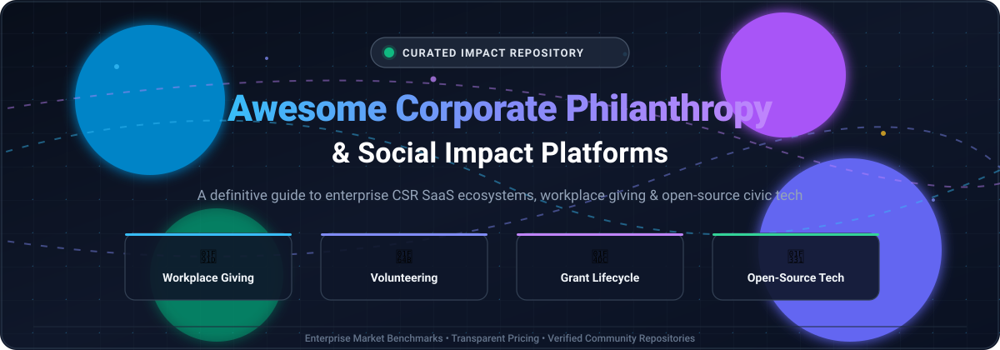

  

  

# 🌟 Awesome Corporate Philanthropy & Social Impact 🌟

**Curated List of Enterprise SaaS Platforms, Workplace Giving Systems & Open-Source Civic Tech**

*A comprehensive directory for CSR leaders, ESG directors, People/HR teams, and nonprofit software engineers.*

---

## 📖 Overview & Mission

Welcome to **Awesome Corporate Philanthropy & Social Impact**! 🚀 This repository tracks leading **enterprise SaaS platforms** and vetted **open-source GitHub projects** powering modern **Corporate Social Responsibility (CSR)**, workplace giving, volunteer management, charitable donation matching, grantmaking, and social impact tracking.

Whether you are evaluating enterprise platforms (such as Benevity, Bonterra CyberGrants, or Blackbaud YourCause) or auditing open-source codebases for civic tech, volunteer hours logging, and community grant distributions, this curated list provides transparent market intelligence, pricing benchmarks, and structural trade-offs.

---

## 📑 Table of Contents

- [📊 Sector Overview & Market Dynamics](#-sector-overview--market-dynamics)
- [🏢 SaaS & Hosted Enterprise Platforms](#-saas--hosted-enterprise-platforms)
- [💻 Open-Source GitHub Projects](#-open-source-github-projects)
- [🤝 How to Contribute](#-how-to-contribute)
- [💖 Support & Community](#-support--community)
- [⚠️ Disclaimer & Compliance Considerations](#-disclaimer--compliance-considerations)
- [📈 Star History](#-star-history)

---

## 📊 Sector Overview & Market Dynamics

The global **Corporate Social Responsibility (CSR) and Corporate Philanthropy software market** is estimated at approximately **$1.1 billion to $1.2 billion** (forecasted to expand past $3.0 billion by the 2030s at ~10% CAGR). 

The market dynamics exhibit a **moderately fragmented structure with a concentrated core of market leaders**:
* **The Concentrated Core (Market Giants):** Tier-1 enterprise giants—notably **Blackbaud (YourCause)**, **Bonterra (CyberGrants, Deed)**, and **Benevity**—command the vast majority of Global 2000 corporate contracts due to the intricate compliance, KYC, anti-money laundering, tax-deductibility vetting, and global cross-border banking rails (150+ countries) required to disburse hundreds of millions in corporate matching funds.
* **The Long Tail (Fragmented Niche & Point Solutions):** Outside the core triopoly, dozens of specialized SaaS tools and point solutions compete for mid-market and SME adoption across virtual employee volunteering events (Goodera), modern mobile donation matching (Millie), grant submission tracking (Submittable), and localized European payroll giving (GivingForce).

---

## 🏢 SaaS & Hosted Enterprise Platforms

The table below benchmarks major commercial vendors handling workplace giving, matching gifts, corporate volunteering, and enterprise grant management. Rows are sorted in **descending order by company size** (market capitalization, private equity backing, valuation, and annual recurring revenue).

| 🏢 Platform | 💰 Company Size (Valuation / Revenue) | 🏷️ Starting Pricing Tier | ⏱️ Free Tier / Trial Limits | ⚡ Key Features & Focus | 🎯 Best For & Trade-offs |
| :--- | :--- | :--- | :--- | :--- | :--- |
| **[YourCause (Blackbaud)](https://www.yourcause.com/)** | **~$2.5B–$2.6B** MCap / **~$1.15B** ARR (NASDAQ: BLKB) | Starting tier from **$10,000/year** (or $5,000/yr base + $99/user modular add-on) | **No free tier or trial** (Requires sales demo; Blackbaud Verified Network / NPOconnect is free for verified 501(c)(3) charities) | Enterprise workplace giving, matching gifts (CSRconnect), and corporate grantmaking (GrantsConnect) | **Best for**: Mid-to-large enterprises seeking modular, proven CSR workflows. **Trade-off**: High entry pricing; complex setup. |
| **[CyberGrants (Bonterra)](https://www.bonterra.com/)** | **~$1B+** PE Backing / **~$200M–$300M+** ARR (Apax Partners) | Enterprise quote-based starting at **$12,000/year** baseline platform contract | **No free tier or trial** (No self-serve or trial access; enterprise onboarding and sales demonstration only) | Enterprise corporate grantmaking, disaster relief funds, employee giving, and volunteer tracking | **Best for**: Large enterprises and corporate foundations needing structured grant approval workflows. **Trade-off**: Requires dedicated implementation and onboarding. |
| **[Deed](https://www.joindeed.com/)** | **Part of Bonterra** (~$1B+ parent); raised **$12.1M** pre-acquisition | Enterprise tier starting at **$10,000/year** baseline platform license fee | **No free tier or trial** (Sales demo only; standard 3rd-party processing fees apply: PayPal 2.2% + $0.30; GlobalGiving 5%) | Modern employee giving, volunteer opportunity discovery, gamified campaigns, Slack integration | **Best for**: Modern, remote/hybrid workforces wanting consumer-grade mobile CSR apps. **Trade-off**: Processing fees vary by payment partner. |
| **[Benevity](https://www.benevity.com/)** | **~$1.1B** Valuation (Hg PE) / **~$130M–$188M** ARR | Starting from **$32,844/year** baseline (median contract ~$49,056/year across enterprise buyers) | **No free tier or trial** (Strictly sales-led enterprise deployment; no free trials or self-serve freemium access) | Corporate purpose software, global donation disbursement (150+ countries), volunteering, and Spark CSR engine | **Best for**: Global enterprises needing unified giving with deep nonprofit vetting. **Trade-off**: Highest starting price tag; strict enterprise contracts. |
| **[Submittable](https://www.submittable.com/)** | **~$500M–$1B** Valuation / **~$35M–$50M+** ARR ($74.6M funding) | Basic tier starting at **$3,000/year** (median CSR/grants buyer pays ~$14,462/year) | **No free trial** (Sales demo evaluation only; paid contract tiers limit monthly/annual submission counts, though paid fee applications do not consume limits) | Grants lifecycle management, awards workflow automation, and CSR module (Bright Funds) | **Best for**: Organizations managing structured grant applications and corporate philanthropy together. **Trade-off**: Contract prices scale with volume caps. |
| **[Bright Funds (Submittable)](https://www.brightfunds.org/)** | **Part of Submittable** (~$500M–$1B parent valuation) | Modular tier starting at **$3,000/year** (bundled CSR deployment median ~$14,462/year) | **14-day free trial** available upon sales qualification (Limited to test employee portal and nonprofit catalog sandbox) | Workplace donation matching, payroll giving, volunteer event coordination, and curated charity database | **Best for**: Fast-growing companies seeking straightforward employee donation matching. **Trade-off**: Pricing opacity; variable payment processing fees. |
| **[Goodera](https://www.goodera.com/)** | **~$10M–$15M** ARR ($10M Series A, backed by Zoom Ventures) | Starting tier from **$5.00/user/month** (annual billing, minimum seat commitments apply) | **No free tier** (Offers a **1-event or 14-day sandbox trial** on select corporate demo inquiries) | Turnkey virtual, in-person, and hybrid corporate volunteering events across 100+ countries | **Best for**: Companies seeking turnkey, hosted team-building volunteering experiences. **Trade-off**: Per-event or per-seat costs scale rapidly with large teams. |
| **[Millie](https://www.milliegiving.com/)** | **~$1.1M** ARR (Seed-stage backed, 25–30 employees) | Starter plan starting at **$95/month** (annual commitment; plus 5% operational transaction fee on donations) | **No free tier or trial** (Guided product demonstration only; contracts capped by active employee count) | Agile workplace giving, corporate matching, charitable gift cards, and gamified campaigns | **Best for**: Small-to-mid-market companies wanting accessible, easy-to-launch CSR tools. **Trade-off**: 5% transaction cut on donation flows. |
| **[GivingForce](https://www.givingforce.com/)** | Private SME (~10–50 employees, UK Companies House registered) | Bespoke modular license starting at **£5,000/year** (~$6,500/year) | **No free tier or trial** (Platform demonstration only; requires custom enterprise portal provisioning) | UK/EU HMRC-recognized payroll giving, corporate gift matching, volunteering portal, grant management | **Best for**: UK/European enterprises prioritizing HMRC payroll giving compliance. **Trade-off**: Niche focus on UK/European corporate giving standards. |

*(Note: **[Atlassian Foundation](https://www.atlassianfoundation.org/)** represents Atlassian's internal corporate philanthropy and Pledge 1% initiative, not a commercial SaaS product or purchasable vendor, and is therefore excluded from commercial software pricing rankings).*

---

## 💻 Open-Source GitHub Projects

Below are open-source repositories designed for volunteer coordination, grant management, and civic CSR platforms. Repositories are sorted in **descending order by GitHub star count**. Each star badge links directly to the project's stargazers page.

- **[rubyforgood/casa](https://github.com/rubyforgood/casa)**  `MIT License`  
  **Volunteer management and child advocacy case tracking system** built in Ruby on Rails. Originally created for Court Appointed Special Advocates (CASA), this battle-tested platform manages volunteer onboarding, case assignments, court report generations, supervisor workflows, and volunteer hours auditing. Excellent production-grade architecture for large-scale volunteer workforce management.

- **[mike-marcacci/gandhi](https://github.com/mike-marcacci/gandhi)**  `AGPL-3.0 License`  
  **Open-source, self-hosted online grant management system**. Provides structured workflows for philanthropic grantmakers and charitable foundations. Features applicant registration, review committee scorecards, milestone tracking, and grant disbursement logging without vendor lock-in.

- **[usdigitalresponse/usdr-gost](https://github.com/usdigitalresponse/usdr-gost)**  `Apache-2.0 License`  
  **Grants discovery and lifecycle management system** built by the U.S. Digital Response team. Tailored for finding, tracking, and allocating federal, state, and philanthropic relief grants. Features automated grant feeds, eligibility filtering, and team collaboration dashboards.

- **[FederationOfTech/Coalesce](https://github.com/FederationOfTech/Coalesce)**  `AGPL-3.0 License`  
  **Modern volunteer management & civic engagement platform** from the Federation of Humanitarian Technologists. Connects nonprofits, civic groups, and companies with volunteers. Includes skills matching, shift scheduling, real-time messaging, and impact reporting.

- **[wiredimpact/wired-impact-volunteer-management](https://github.com/wiredimpact/wired-impact-volunteer-management)**  `GPL-2.0 License`  
  **WordPress volunteer management plugin** for charitable organizations and corporate volunteer liaisons. Simplifies publishing volunteer opportunities, collecting RSVPs, automated reminder notifications, and tracking volunteer participation hours directly within CMS infrastructure.

- **[deepshig/Financial-Grant-Management-System](https://github.com/deepshig/Financial-Grant-Management-System)**  `Apache-2.0 License`  
  **Financial grant allocation & tracking system** designed for managing institutional grants, corporate social funding allocations, and research sponsorships. Tracks budget disbursement milestones, project deliverables, and expense accounting.

- **[souravmalviya/CSR-Management-Application](https://github.com/souravmalviya/CSR-Management-Application)**  `Open Access`  
  **Corporate Social Responsibility project and funds tracker**. Allows corporate sustainability desks to monitor CSR projects across healthcare, education, and rural development, providing real-time expenditure audits against statutory corporate giving obligations.

- **[lbraun/csr_lookup](https://github.com/lbraun/csr_lookup)**  `MIT License`  
  **Corporate social responsibility lookup and rating tool**. Demonstrates automated fetching and scoring of public CSR, environmental, and corporate governance metrics, providing a blueprint for internal ESG screening utilities.

- **[Jainendra0102/Sync-Sphere](https://github.com/Jainendra0102/Sync-Sphere)**  `Open Access`  
  **CSR collaboration portal connecting NGOs, companies, and volunteers**. Demonstrates company-to-NGO matching, project category filtering (environment, education, hunger relief), direct donation links, and AI-assisted project discovery.

---

## 🤝 How to Contribute

Contributions are warmly encouraged! 🎉 Help keep this resource comprehensive, up-to-date, and valuable for the social impact community:

1. **Fork the repository** 🍴
2. **Create a descriptive feature branch** (`git checkout -b add-impact-platform`) 🌿
3. **Add or refine listings**:
   - For SaaS products, include verifiable starting price tiers, free trial details, and company valuation/revenue benchmarks.
   - For open-source repos, include star counts, license details, and a clear architectural summary.
4. **Follow the formatting guidelines** and verify links.
5. **Open a Pull Request** with a concise description of your additions! 🚀

---

## 💖 Support & Community

If this curated guide helps your team design, evaluate, or implement corporate philanthropy and social impact technology:

- ⭐ **Star this repository** to help others discover it!
- 🍴 **Fork and share** it with your CSR committees, HR teams, and developer networks.
- 💬 **Join our community** on [Discord](https://discord.gg/jc4xtF58Ve) for discussions on social good tech.
- ☕ **Sponsor or buy a coffee**: Support ongoing maintenance and research via the [GitHub Sponsors Dashboard](https://github.com/sponsors/ishandutta2007)!

---

## ⚠️ Disclaimer & Compliance Considerations

- **Community-Curated**: This repository is for informational and educational purposes only and does not constitute financial, legal, or procurement advice.
- **Charitable Compliance & Data Privacy**: Corporate philanthropy systems handle sensitive employee payroll deductions, personal identifying information (PII), and financial transactions. Deployments must comply with international tax laws (e.g., IRS 501(c)(3) in the US, HMRC Gift Aid in the UK), data privacy mandates (GDPR, CCPA), and anti-money laundering (AML/OFAC) regulations.
- **Vetting Infrastructure**: Proprietary enterprise platforms (Benevity, YourCause, CyberGrants) invest millions in maintaining real-time global charity databases and disbursement rails. Open-source self-hosted solutions require third-party payment gateways and manual nonprofit vetting.

---

## 📈 Star History

---

Made with ❤️ for corporate changemakers, foundation leaders, and civic hackers worldwide.

